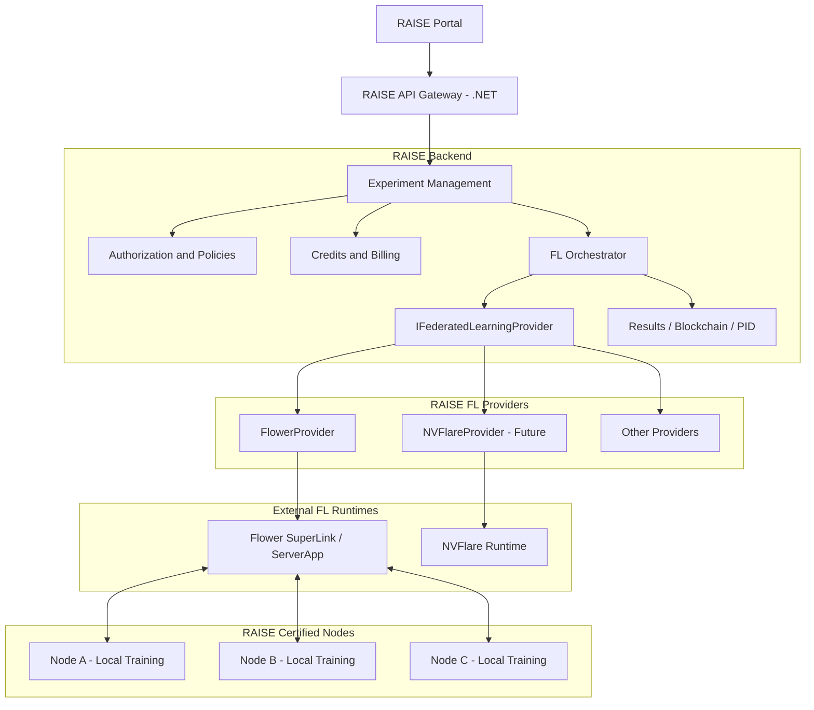
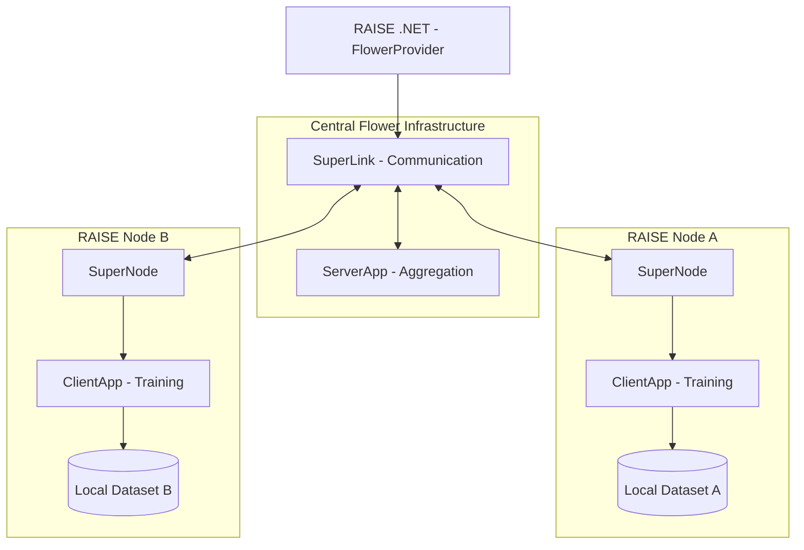
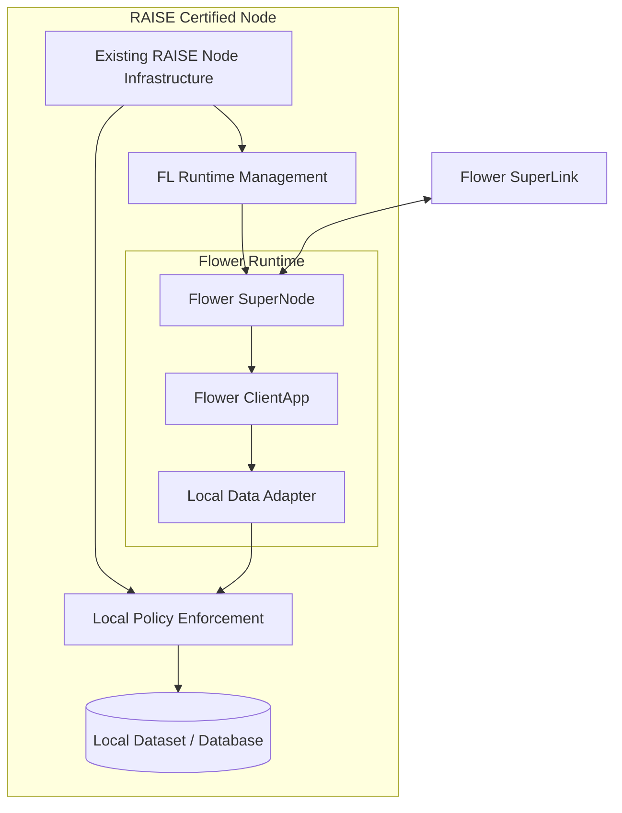
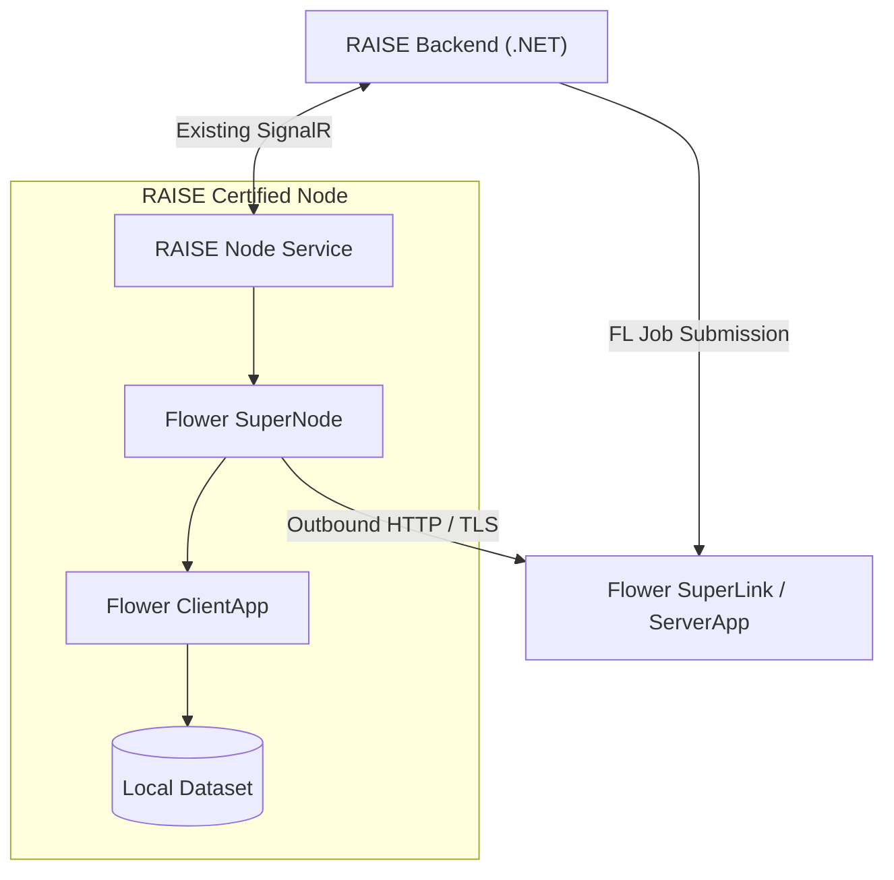
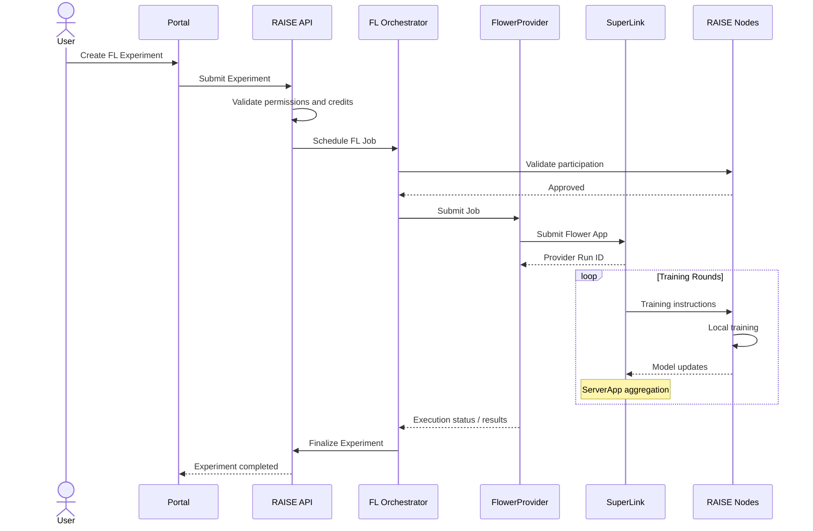
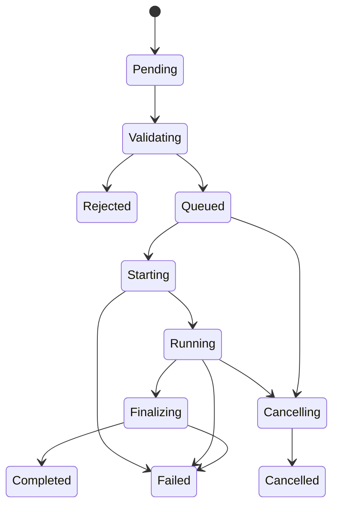

---
categories:
  - "[[Work]]"
created: 2026-11-03
product: RAISE
component: Federated Learning
tags:
  - topic/code
  - tech/signalR
  - tech/api
  - tech/machine-learning
  - topic/
---
# RAISE Federated Learning Architecture
**Version:** 1.3 – Proposed
​
**Date:** 03/11/2026
​
**Status:** Architecture for Review
​
**Scope:** Federated Learning Integration into RAISE

---
## 1. Executive Summary
Το RAISE θα επεκταθεί ώστε να υποστηρίζει Federated Learning (FL), επιτρέποντας σε ερευνητές να εκπαιδεύουν μοντέλα Machine Learning χρησιμοποιώντας datasets κατανεμημένα σε διαφορετικούς RAISE Certified Nodes (RCNs).
Η εκπαίδευση πραγματοποιείται τοπικά στους Nodes. Τα αρχικά δεδομένα δεν μεταφέρονται στον κεντρικό RAISE Hub ή σε άλλους συμμετέχοντες Nodes.
Η αρχιτεκτονική βασίζεται στις ακόλουθες αρχές:
1. Το υπάρχον **RAISE API Gateway (.NET)** παραμένει το application backend.
2. Το Federated Learning orchestration ενσωματώνεται στο υπάρχον .NET backend.
3. Χρησιμοποιείται provider-based architecture ώστε το RAISE να μην εξαρτάται από συγκεκριμένο FL framework.
4. Το Flower αποτελεί τον πρώτο υποψήφιο provider.
5. Επαναχρησιμοποιούνται οι υφιστάμενοι μηχανισμοί RAISE για datasets, users, access rights, credits, experiments, blockchain και persistent identifiers.
6. Οι πολιτικές ασφαλείας εφαρμόζονται τόσο κεντρικά όσο και τοπικά στους Nodes.
7. Τα FL frameworks εκτελούνται ως ανεξάρτητα runtimes, χωρίς πρόσθετο RAISE application API.
### Architecture Decision AD-001
**Direct .NET integration with pluggable FL providers.**
Το RAISE επικοινωνεί απευθείας με το επιλεγμένο FL framework μέσω provider adapters.
Η διαχείριση των Experiments παραμένει στο RAISE, ενώ το FL framework αναλαμβάνει την κατανεμημένη εκπαίδευση και το aggregation.
Για το Flower, η εκτέλεση βασίζεται στα components SuperLink, ServerApp, SuperNode και ClientApp, τα οποία περιγράφονται αναλυτικότερα στην ενότητα 6.

---
## 2. Scope και Requirements
### 2.1 Functional Requirements

|ID|Requirement|
|---|---|
|FR-01|Δημιουργία Federated Learning Experiment από το RAISE Portal|
|FR-02|Επιλογή πολλαπλών datasets και RAISE Nodes|
|FR-03|Επιλογή FL framework και training configuration|
|FR-04|Έλεγχος πρόσβασης και συμβατότητας πολιτικών|
|FR-05|Εκτέλεση local training στους Nodes|
|FR-06|Aggregation των model updates|
|FR-07|Παρακολούθηση rounds, progress και metrics|
|FR-08|Υποστήριξη cancellation και αποτυχημένων Nodes|
|FR-09|Καταχώριση final model, metrics και execution provenance|
|FR-10|Ενσωμάτωση με credits, blockchain και DOI/PID|
|FR-11|Υποστήριξη διαφορετικών FL frameworks|
### 2.2 Non-Functional Requirements
- **Security:** Τα αρχικά datasets παραμένουν στους Nodes.
- **Isolation:** Τα training scripts εκτελούνται σε απομονωμένα environments.
- **Extensibility:** Νέα frameworks προστίθενται μέσω providers.
- **Reliability:** Τα jobs διατηρούν την κατάστασή τους μετά από επανεκκίνηση.
- **Traceability:** Κάθε εκτέλεση συνδέεται με Experiment, datasets, Nodes και model.
- **Compatibility:** Δεν επηρεάζεται η υπάρχουσα εκτέλεση RAISE Experiments.
- **Interoperability:** Χρήση framework-neutral interfaces.

---
## 3. Existing RAISE Architecture
Το RAISE διαθέτει ήδη σημαντικά components που μπορούν να αξιοποιηθούν.

|Component|Υπάρχουσα βάση|Προβλεπόμενη αξιοποίηση|
|---|---|---|
|Portal|Angular Portal|FL experiment creation/monitoring|
|API Gateway|`Raise.APIGateway`|FL orchestration|
|Experiment Management|`ExperimentService`|FL experiment lifecycle|
|Experiment Scheduling|`ExperimentSchedulingService`|Scheduling FL jobs|
|Dataset Management|`DatasetService`|Dataset permissions|
|Node Management|`NodeService`, `NodeHub`|Node discovery/status|
|Credits|`CreditService`|Cost estimation και settlement|
|Blockchain|`BlockchainService`|Execution proofs|
|PID Services|`FAIRPidService`|Provenance και publication|
|Authentication|Keycloak|User identity και authorization|
Η δυνατότητα επαναχρησιμοποίησης των επιμέρους services πρέπει να επιβεβαιωθεί κατά τον έλεγχο του source code.

---
## 4. High-Level Architecture

### Architectural Boundaries
**RAISE Core:** Διαχειρίζεται experiments, permissions, credits, scheduling, results και provenance.
**FL Provider Layer:** Μεταφράζει τις εντολές του RAISE στις λειτουργίες του επιλεγμένου FL framework.
**FL Runtime:** Εκτελεί την κατανεμημένη εκπαίδευση, την επικοινωνία μεταξύ participants και το aggregation.

---
## 5. RAISE Backend Components
### 5.1 FederatedLearningOrchestrator
Νέο εσωτερικό .NET component.
Αρμοδιότητες:
- Προετοιμασία και validation FL jobs.
- Επιλογή FL provider.
- Επιβεβαίωση διαθεσιμότητας Nodes.
- Εκκίνηση και παρακολούθηση εκτέλεσης.
- Χειρισμός αποτυχιών και cancellation.
- Καταχώριση αποτελεσμάτων στο υπάρχον Experiment Management.
Δεν εκτελεί ο ίδιος το model training ή aggregation.
### 5.2 IFederatedLearningProvider
Κοινό .NET interface που υλοποιείται από κάθε FL provider.
```
public interface IFederatedLearningProvider
{
    string ProviderId { get; }
    Task<FLProviderCapabilities> GetCapabilitiesAsync(
        CancellationToken ct);
    Task<FLValidationResult> ValidateAsync(
        FLJobRequest request,
        CancellationToken ct);
    Task<FLSubmissionResult> SubmitAsync(
        FLJobRequest request,
        CancellationToken ct);
    Task<FLJobStatus> GetStatusAsync(
        string providerRunId,
        CancellationToken ct);
    Task StopAsync(
        string providerRunId,
        CancellationToken ct);
    Task<FLResults> GetResultsAsync(
        string providerRunId,
        CancellationToken ct);
}
```
Κάθε framework υλοποιεί το ίδιο interface, διατηρώντας τις δικές του τεχνικές λεπτομέρειες.
### 5.3 Provider Capabilities
Κάθε provider δηλώνει τις δυνατότητές του:
- Supported ML frameworks.
- Aggregation strategies.
- Secure aggregation.
- Differential privacy.
- Participant requirements.
- Cancellation/restart capabilities.
- Runtime compatibility.
Το RAISE ελέγχει τις δυνατότητες πριν από την εκτέλεση του Experiment.
### 5.4 Provider Registration
Οι providers καταχωρίζονται μέσω .NET Dependency Injection.
```
services.AddScoped<
    IFederatedLearningProvider,
    FlowerProvider>();
services.AddScoped<
    IFederatedLearningProvider,
    NVFlareProvider>();
services.AddScoped<
    IFederatedLearningProviderResolver,
    FederatedLearningProviderResolver>();
```
Ο resolver επιλέγει τον κατάλληλο provider με βάση το Experiment configuration.

---
## 6. Federated Learning Framework Architecture
### 6.1 Τι προσφέρει ένα FL Framework
Ένα Federated Learning framework αναλαμβάνει τη συνεργασία πολλών υπολογιστικών κόμβων για την εκπαίδευση ενός κοινού μοντέλου.
Αντί να συγκεντρώνει όλα τα δεδομένα σε ένα σημείο, μεταφέρει το μοντέλο στους κόμβους, οι οποίοι το εκπαιδεύουν τοπικά.
Στη συνέχεια, συγκεντρώνει τα model updates και δημιουργεί μια νέα έκδοση του global model.
Η διαδικασία επαναλαμβάνεται για προκαθορισμένο αριθμό training rounds.
Το RAISE δεν χρειάζεται να υλοποιήσει τους μηχανισμούς αυτούς. Τους αναλαμβάνει το FL framework.
### 6.2 Flower Components
Το Flower χρησιμοποιεί τέσσερα βασικά components.

|Component|Τοποθεσία|Ρόλος|
|---|---|---|
|**SuperLink**|Central infrastructure|Υποδομή επικοινωνίας και συντονισμού|
|**ServerApp**|Central infrastructure|Training strategy και aggregation|
|**SuperNode**|RAISE Node|Σύνδεση ενός participant στο Flower|
|**ClientApp**|RAISE Node|Εκτέλεση local model training|
#### SuperLink
Το SuperLink είναι η κεντρική υποδομή επικοινωνίας του Flower.
- Διαχειρίζεται τις συνδέσεις με τους SuperNodes.
- Μεταφέρει τα training instructions και τα model updates.
- Υποστηρίζει τη διαχείριση των FL runs.
- Παρέχει τις απαραίτητες υπηρεσίες για την εκτέλεση των ServerApps.
Δεν υλοποιεί το ίδιο τον αλγόριθμο aggregation.
#### ServerApp
Το ServerApp περιέχει τη λογική της κεντρικής εκπαίδευσης.
- Ορίζει την aggregation strategy, π.χ. FedAvg.
- Καθορίζει πόσοι training rounds θα εκτελεστούν.
- Επιλέγει τους διαθέσιμους participants.
- Συνδυάζει τα model updates.
- Δημιουργεί τις νέες εκδόσεις του global model.
**Παράδειγμα:** Λαμβάνει ενημερωμένες παραμέτρους από τρεις Nodes και τις συνδυάζει σε ένα νέο global model.
#### SuperNode
Το SuperNode είναι η υποδομή Flower που εκτελείται στον συμμετέχοντα Node.
- Συνδέεται με το SuperLink.
- Λαμβάνει training tasks.
- Εκκινεί ή εξυπηρετεί την εκτέλεση της αντίστοιχης ClientApp.
- Επιστρέφει model updates και metrics.
Δεν είναι απαραίτητα το ίδιο το training script.
Στο RAISE, κάθε συμμετέχων Certified Node θα φιλοξενεί ένα SuperNode για το Flower runtime.
#### ClientApp
Το ClientApp περιλαμβάνει τον πραγματικό κώδικα local training.
- Φορτώνει το μοντέλο.
- Αποκτά πρόσβαση στο επιτρεπόμενο τοπικό dataset.
- Εκτελεί training ή evaluation.
- Επιστρέφει model updates και metrics.
**Παράδειγμα:** Ένας ερευνητής χρησιμοποιεί PyTorch για να εκπαιδεύσει ένα neural network στα δεδομένα ενός RAISE Node.
Το ClientApp εκτελεί αυτή την εκπαίδευση και το Flower αναλαμβάνει τη συμμετοχή του στο συνολικό FL workflow.
### 6.3 Πώς συνεργάζονται

Η βασική διαδικασία είναι:
1. Το RAISE υποβάλλει το FL job στο Flower.
2. Το ServerApp αρχικοποιεί το global model και το training strategy.
3. Μέσω SuperLink τα training tasks φτάνουν στους SuperNodes.
4. Τα ClientApps εκπαιδεύουν το μοντέλο στα τοπικά datasets.
5. Τα model updates επιστρέφουν στο ServerApp, μέσω της υποδομής Flower.
6. Το ServerApp πραγματοποιεί aggregation.
7. Η διαδικασία επαναλαμβάνεται μέχρι να ολοκληρωθούν οι rounds.
Το RAISE παρακολουθεί την εκτέλεση και καταχωρίζει τα αποτελέσματα.
### 6.4 Flower Application
Το Flower χρησιμοποιεί την έννοια του **Flower App**.
Πρόκειται για ένα πακέτο εφαρμογής που περιλαμβάνει τη λογική ServerApp και ClientApp, μαζί με το απαραίτητο configuration.
Έτσι διαχωρίζονται:
- Η υποδομή εκτέλεσης του Flower.
- Ο κώδικας του συγκεκριμένου ML experiment.
Το RAISE θα πρέπει να μπορεί να δημιουργεί ή να προετοιμάζει ένα συμβατό Flower App από το training artifact που παρέχει ο ερευνητής.
Η ακριβής διαδικασία packaging αποτελεί μέρος του Flower Provider.
### 6.5 FlowerProvider Integration
Ο `FlowerProvider` αποτελεί τον adapter μεταξύ RAISE και Flower.
Επικοινωνεί με το SuperLink μέσω του διαθέσιμου Flower Control API, εφόσον επιβεβαιωθεί η συμβατότητά του με native .NET HTTP client.
Εναλλακτικά μπορεί να χρησιμοποιηθεί το Flower CLI ως managed process.
Οι δύο επιλογές παραμένουν εσωτερικές λεπτομέρειες του FlowerProvider και δεν επηρεάζουν το υπόλοιπο RAISE.
### 6.6 Αντικατάσταση FL Framework
Η αρχιτεκτονική δεν περιορίζεται στο Flower.
Για παράδειγμα, αν χρησιμοποιηθεί NVIDIA FLARE:
- Το `FlowerProvider` αντικαθίσταται από `NVFlareProvider`.
- Το Flower runtime αντικαθίσταται από το αντίστοιχο NVIDIA FLARE runtime.
- Οι Nodes αποκτούν συμβατό client/runtime.
- Το RAISE Experiment Management παραμένει αμετάβλητο.
Το κοινό interface εξασφαλίζει ανεξαρτησία στο επίπεδο orchestration. Δεν σημαίνει ότι τα training scripts ή τα runtime components είναι αυτόματα συμβατά μεταξύ frameworks.

---
## 7. RAISE Node Architecture
Κάθε RAISE Node θα υποστηρίζει την εγκατάσταση FL runtimes.

### 7.1 Node Communication Architecture
Οι RAISE Nodes λειτουργούν σε σχετικά απομονωμένα δίκτυα και **δεν δέχονται εισερχόμενα API requests**.
Μπορούν, ωστόσο, να δημιουργούν εξερχόμενες HTTP/HTTPS συνδέσεις.
Η επικοινωνία διαχωρίζεται σε δύο ανεξάρτητους διαύλους:

**RAISE SignalR**
- Παραμένει ο υπάρχων μηχανισμός επικοινωνίας Backend–Node.
- Χρησιμοποιείται για management, status και coordination.
- Μπορεί να χρησιμοποιηθεί για διαχείριση του τοπικού FL runtime.
**Flower Communication**
- Ο SuperNode δημιουργεί εξερχόμενη σύνδεση προς το κεντρικό SuperLink.
- Η επικοινωνία πραγματοποιείται μέσω του Flower Fleet API με HTTP/TLS.
- Μεταφέρονται training instructions, model updates και metrics.
- Δεν απαιτούνται εισερχόμενα API endpoints στον Node.
Η κεντρική υποδομή Flower πρέπει να είναι προσβάσιμη από τους Nodes μέσω επιτρεπόμενων εξερχόμενων συνδέσεων.
**Architecture Decision AD-013 – Node Communication**
Οι RAISE Nodes δεν εκθέτουν εισερχόμενα APIs για το Federated Learning. Το υφιστάμενο SignalR παραμένει για management, ενώ το Flower χρησιμοποιεί ανεξάρτητες εξερχόμενες συνδέσεις προς το SuperLink.
### Node Responsibilities
- Διατήρηση των δεδομένων τοπικά.
- Διαχείριση διαθέσιμων FL runtimes.
- Έλεγχος δικαιωμάτων και πολιτικών πρόσβασης.
- Εκτέλεση local training.
- Επιστροφή επιτρεπόμενων model updates και metrics.
- Καταγραφή execution logs.
### Local Data Adapter
Ο Data Adapter επιτρέπει στο ClientApp να χρησιμοποιήσει το εγκεκριμένο dataset.
Μπορεί να συνδέεται με βάση δεδομένων, αρχεία ή άλλη τοπική πηγή.
Ο Adapter πρέπει να εφαρμόζει τους περιορισμούς πρόσβασης που ορίζει το RAISE.
### Runtime Management
Προτείνεται abstraction `INodeFederatedRuntimeManager` για:
- Εγκατάσταση και αναβάθμιση FL runtimes.
- Έλεγχο εκδόσεων και συμβατότητας.
- Start/stop και health monitoring.
Για το αρχικό MVP η εγκατάσταση μπορεί να γίνεται διαχειριστικά.

---
## 8. Federated Learning Experiment Lifecycle

Στο διάγραμμα, η επικοινωνία RAISE Backend–Node για participation validation πραγματοποιείται μέσω του υπάρχοντος SignalR. Η επικοινωνία SuperLink–SuperNode υλοποιείται με συνδέσεις που ξεκινούν από τον Node.
### Preflight
Πριν από την εκτέλεση ελέγχονται:
1. Experiment authorization.
2. Dataset access rights.
3. Node availability και compatibility.
4. Training artifact validity.
5. Privacy policies.
6. Credit availability.
### Training
Το FL framework πραγματοποιεί την εκπαίδευση και aggregation.
Για το MVP προτείνεται synchronous training με PyTorch και FedAvg.
### Finalization
Το RAISE:
- Παραλαμβάνει τα αποτελέσματα.
- Καταχωρίζει metrics και model artifacts.
- Ολοκληρώνει τις χρεώσεις.
- Καταγράφει provenance και blockchain proofs.
- Ενημερώνει το Experiment status.

---
## 9. FL Job State Management
Προτείνεται ανεξάρτητο FL Job state συνδεδεμένο με το υπάρχον Experiment.

Το RAISE αποθηκεύει το state στη βάση δεδομένων.
Background reconciliation επαναφέρει την κατάσταση μετά από restart ή προσωρινή αποτυχία επικοινωνίας με τον provider.

---
## 10. Persistence Model
### FederatedJob

|Field|Description|
|---|---|
|Id|FL Job ID|
|ExperimentId|Existing RAISE Experiment|
|ProviderId|FL provider|
|ProviderVersion|Provider/runtime version|
|ProviderRunId|External execution identifier|
|Status|FL job status|
|Configuration|Training configuration|
|PolicySnapshot|Applied security policies|
|ArtifactHash|Training artifact checksum|
|StartedAt / FinishedAt|Execution timestamps|
|CreditReservationId|Credit reservation|
### FederatedJobParticipant
- FederatedJobId.
- NodeId.
- DatasetId.
- ParticipationStatus.
- RuntimeVersion.
- LastHeartbeat.
- ErrorCode.
### FederatedJobEvent
Καταγράφει τις σημαντικές αλλαγές κατάστασης και τα execution events.
Τα model artifacts αποθηκεύονται σε object storage, όχι ως μεγάλα database records.

---
## 11. Security and Privacy
### Authorization
Το RAISE διατηρεί τον κεντρικό έλεγχο των δικαιωμάτων.
Ο Node πρέπει να επαληθεύει τοπικά ότι το Experiment έχει πρόσβαση στο συγκεκριμένο dataset. (We rely on raise service for this but we can use the SignalR to read the rights if necessary)
### Data Privacy
Τα raw datasets δεν αποστέλλονται στο FL framework.
Ωστόσο τα model updates μπορεί να αποκαλύπτουν πληροφορίες για τα training data.
Για τον λόγο αυτό προβλέπεται υποστήριξη:
- Secure aggregation.
- Differential privacy.
- Update clipping.
- Privacy-aware metrics.
- Minimum participant requirements.
### Data Access Policies
Πολιτικές όπως χρήση μόνο του 10% ενός dataset πρέπει να εφαρμόζονται κατά το local training.
Χρειάζεται ξεχωριστός ορισμός για την εφαρμογή τέτοιων πολιτικών σε πολλαπλά rounds και Experiments.
### Isolation
Τα training scripts εκτελούνται σε απομονωμένα containers ή ισοδύναμα ασφαλή environments, με περιορισμένη πρόσβαση σε δίκτυο και filesystem.

---
## 12. Results, Credits, Blockchain and PID
### Results
Κάθε Experiment μπορεί να παράγει:
- Final model.
- Training/evaluation metrics.
- Aggregation summary.
- Participant information.
- Training configuration.
- Execution provenance.
### Credits
Το RAISE χρησιμοποιεί το υπάρχον σύστημα credits για estimation, reservation και settlement.
Το ακριβές FL pricing model παραμένει ανοιχτό.
### Blockchain
Καταγράφονται proofs που μπορούν να περιλαμβάνουν:
- Experiment ID.
- Dataset references.
- Training artifact hash.
- Model hash.
- Execution provenance.
Δεν αποθηκεύονται raw data ή model weights στο blockchain.
### DOI/PID
Η έκδοση DOI/PID είναι προαιρετική και ακολουθεί τις υπάρχουσες πολιτικές δημοσίευσης του RAISE.

---
## 13. Portal and API Integration
### Portal
Το FL ενσωματώνεται στο υπάρχον Experiment workflow.
Ο ερευνητής μπορεί να:
- Επιλέξει Experiment Type: Standard / Federated Learning.
- Επιλέξει datasets και Nodes.
- Επιλέξει framework.
- Ορίσει training configuration.
- Εκκινήσει και παρακολουθήσει το Experiment.
- Προβάλει αποτελέσματα.
### RAISE API
Προτείνεται επέκταση των υπαρχόντων Experiment endpoints.
Ενδεικτικά:
- `POST /experiment/run`
- `GET /experiment/{id}`
- `GET /experiment/{id}/fl-status`
- `POST /experiment/{id}/cancel`
- `GET /experiment/{id}/fl-results`
Η τελική μορφή εξαρτάται από τα υπάρχοντα API contracts.

---
## 14. Deployment Architecture
### Central Infrastructure
- RAISE Portal.
- RAISE API Gateway (.NET).
- FL Orchestrator.
- Provider adapters.
- Background monitoring/reconciliation.
- Flower SuperLink.
- Flower ServerApp runtime.
- Existing database και object storage.
### Node Infrastructure
- Existing RAISE Node.
- Flower SuperNode.
- Flower ClientApp runtime.
- Local Dataset Adapter.
- Policy Enforcement.
- Execution isolation.
Το Flower runtime μπορεί να αναπτυχθεί σε Docker containers, ανεξάρτητα από το .NET backend.
**Network requirement:** Οι Nodes πρέπει να έχουν εξερχόμενη πρόσβαση προς το Flower SuperLink. Δεν απαιτούνται εισερχόμενες συνδέσεις από την κεντρική υποδομή προς τους Nodes.
Δεν απαιτείται ξεχωριστό RAISE FL HTTP API.

---
## 15. Observability and Failure Handling
### Monitoring
Το RAISE παρακολουθεί:
- Active/queued/failed jobs.
- Round progress.
- Node participation.
- Provider connectivity.
- Resource usage.
- Training metrics.
- Credits.
### Failure Handling

|Failure|Behaviour|
|---|---|
|RAISE API restart|State recovery|
|Provider unavailable|Retry/reconciliation|
|Node offline|Quorum/participation policy|
|Unauthorized dataset|Reject|
|Training failure|Failed job|
|Cancellation|Provider cancellation|
|Result storage failure|Finalization retry|
Το Experiment ολοκληρώνεται μόνο όταν έχουν καταχωριστεί τα απαιτούμενα αποτελέσματα.

---
## 16. Proposed .NET Solution Structure
```
RaiseServices.Domain/
    FederatedLearning/
        FederatedJob.cs
        FederatedJobParticipant.cs
        FederatedJobStatus.cs
Raise.APIGateway/
    FederatedLearning/
        Abstractions/
            IFederatedLearningProvider.cs
            IFederatedLearningProviderResolver.cs
        Orchestration/
            FederatedLearningOrchestrator.cs
            FederatedJobWorker.cs
        Providers/
            Flower/
                FlowerProvider.cs
                FlowerControlClient.cs
                FlowerConfigurationMapper.cs
            NVFlare/
                NVFlareProvider.cs
        Contracts/
            FLJobRequest.cs
            FLJobStatus.cs
            FLResults.cs
            FLProviderCapabilities.cs
RaiseServices.Infrastructure/
    FederatedLearning/
        FederatedJobConfiguration.cs
        FederatedJobRepository.cs
```
Η δομή είναι προτεινόμενη και μπορεί να προσαρμοστεί στα υπάρχοντα projects.

---
## 17. MVP Definition
### Phase 1 – Technical Integration
- Flower provider.
- Ένας κεντρικός SuperLink.
- Δύο RAISE Nodes.
- PyTorch training.
- FedAvg.
- Προκαθορισμένο Flower App.
- Direct .NET integration.
- Basic status/results/cancellation.
- Outbound-only Flower communication από τους Nodes.
### Phase 2 – RAISE Integration
- Portal workflow.
- Dataset permissions.
- Local policy enforcement.
- Credits.
- Blockchain provenance.
- Results storage.
- Monitoring και recovery.
### Phase 3 – Framework Independence
- Δεύτερος FL provider.
- Runtime compatibility checks.
- Provider switching.
- Κοινό RAISE Experiment workflow.
### Phase 4 – Advanced FL
- Secure aggregation.
- Differential privacy.
- Advanced aggregation algorithms.
- Checkpoints/recovery.
- User-supplied training scripts.
- Model registry/versioning.

---
## 18. Acceptance Criteria
1. Δημιουργία FL Experiment από το RAISE Portal.
2. Local training σε τουλάχιστον δύο Nodes.
3. Καμία μεταφορά raw datasets.
4. Καταγραφή job lifecycle και results.
5. Έλεγχος access rights και local policies.
6. Recovery μετά από RAISE restart.
7. Credits και provenance integration.
8. Αλλαγή FL provider χωρίς αλλαγή του RAISE Experiment workflow.
9. Διαχείριση συμβατών runtimes στους Nodes.
10. Καμία απαίτηση εισερχόμενων API calls προς τους RAISE Nodes.

---
## 19. Open Architectural Decisions

|ID|Decision|Status|
|---|---|---|
|AD-001|Direct .NET integration|Agreed|
|AD-002|Pluggable FL providers|Agreed|
|AD-003|Flower as first provider|Proposed|
|AD-004|Flower Control API vs CLI|Requires PoC|
|AD-005|Experiment schema extension|Open|
|AD-006|Node runtime provisioning|Open|
|AD-007|Training artifact contract|Open|
|AD-008|Dataset usage policies across rounds|Open|
|AD-009|FL pricing model|Open|
|AD-010|Secure aggregation/DP requirements|Open|
|AD-011|Model storage/publication|Open|
|AD-013|SignalR management + outbound FL communication|Agreed|

---
## 20. Architectural Risks
**Provider abstraction leakage:** Framework-specific λειτουργίες μπορεί να εισέλθουν στον κοινό RAISE Core.
**Runtime compatibility:** Διαφορετικά frameworks απαιτούν διαφορετικά runtime components και ενδεχομένως διαφορετικό training code.
**Flower API stability:** Η native .NET διασύνδεση πρέπει να επικυρωθεί με συγκεκριμένη έκδοση Flower.
**Privacy leakage:** Model updates και metrics ενδέχεται να εκθέσουν πληροφορίες.
**Distributed state consistency:** Αποτυχίες επικοινωνίας μπορεί να δημιουργήσουν ασυμφωνία μεταξύ RAISE και FL runtime.
**Network restrictions:** Η σύνδεση των SuperNodes προς το SuperLink εξαρτάται από την εξερχόμενη πρόσβαση και τους αντίστοιχους κανόνες firewall.

---
## 21. Architecture Responsibilities

|Component|Responsibility|
|---|---|
|**RAISE Portal**|Experiment creation και monitoring|
|**RAISE Backend**|Authorization, orchestration, credits, results|
|**FL Provider**|Integration με συγκεκριμένο framework|
|**SuperLink**|Flower communication και runtime coordination|
|**ServerApp**|Aggregation και training strategy|
|**SuperNode**|Flower participant runtime με outbound connection|
|**ClientApp**|Local model training|
|**RAISE Node**|Dataset ownership, local policy enforcement και execution environment|
Η βασική αρχή είναι ότι **το RAISE διαχειρίζεται το Experiment, ενώ το FL framework εκτελεί την κατανεμημένη εκπαίδευση**.
Η αντικατάσταση ενός FL framework πρέπει να επηρεάζει μόνο τα provider adapters και τα αντίστοιχα runtime components, όχι την επιχειρησιακή λογική του RAISE.

---
## 22. References
**RAISE project material**
- `Backend-tree.txt`
- `Portal-tree.txt`
- `swagger.json`
- `RAISE-Suite_Full_Architecture-v1.2.drawio`
- `Annex 1 - Description of the action (part A).pdf`
**External technical references**
- [Flower Framework Documentation](https://flower.ai/docs/framework/)
- [Flower Network Communication](https://flower.ai/docs/framework/main/en/ref-flower-network-communication.html)
- [Flower CLI Reference](https://flower.ai/docs/framework/ref-api-cli.html)
- [Flower Secure Aggregation](https://flower.ai/docs/framework/explanation-ref-secure-aggregation-protocols.html)
- [NVIDIA FLARE](https://nvidia.github.io/NVFlare/)
**Document Status:** Proposed Architecture – Pending technical validation.